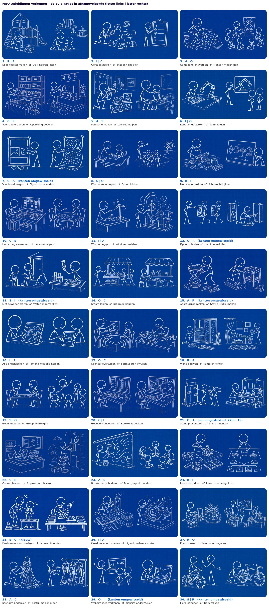

# Van 62 naar 30 plaatjes: ontwerp en onderbouwing

Datum: 2026-11-18

Dit document legt uit welke 30 plaatjes zijn gekozen, waarom, en wat er verder is veranderd om de uitkomsten gevarieerder en kloppender te maken. De cijfers komen uit `tests/riasoc_model_audit.js` (600 gesimuleerde leerlingen per groep, vaste seed) en uit een nulmeting op de vorige versie (commit `f613e5c`).

## 1. Wat was er mis

De klacht was dat er steeds dezelfde uitkomsten uit kwamen. Dat bleek drie oorzaken te hebben.

**De bijpunten duwden profielen in drie hoeken.** Elke keuze gaf 3 punten aan de hoofdletter en 1 punt aan een vaste buurletter: Realistisch gaf altijd een punt aan Conventioneel, Sociaal aan Ondernemend, Intellectueel aan Artistiek. Daardoor bewogen die letters samen. Bij 600 willekeurige klikkers:

| | Oud (62 vragen, weging 3/1) | Ideaal |
|---|---|---|
| Letter op plek 1 | R 18%, I 26%, A 16%, S 13%, O 14%, C 13% | elk 16,7% |
| Samenhang tussen letters | van -0,46 tot +0,50 | alle rond -0,20 |
| Vaakste / zeldzaamste top-3 | 68x / 7x | elk 30x |

Wie zonder enige voorkeur klikte, kwam dus twee keer zo vaak op Intellectueel uit als op Conventioneel.

**De kant van het plaatje telde mee.** Realistisch en Intellectueel stonden bijna altijd links, Sociaal en Ondernemend bijna altijd rechts. Wie steeds links klikte kreeg R 76%, I 80%, A 69% en leek daarmee een uitgesproken techneut.

**De opleidingsmatch koos steeds dezelfde opleidingen.** Dit was de grootste oorzaak.

- De match was een optelsom (score leerling x score opleiding). Opleidingen die op alles redelijk hoog scoren wonnen daardoor bij bijna iedereen.
- De 400 opleidingen hebben samen maar 37 verschillende RIASOC-profielen. 77 techniekopleidingen hadden exact hetzelfde profiel. Bij gelijke match won altijd de opleiding die toevallig bovenaan in het bestand stond.
- De profielcorrectie zocht trefwoorden ook in straatnamen en URL's. "Marten Mees**weg**" maakte van Apothekersassistent een techniekopleiding, "tran**sport**" maakte van logistiek een sportopleiding, en Hovenier, Chauffeur en Beveiliger kregen het profiel van een hospitality-opleiding.

Het gevolg bij 600 willekeurige klikkers: 60 van de 400 opleidingen kwamen ooit in beeld, en 70% van de leerlingen kreeg dezelfde opleiding te zien (productiemedewerker voedingsindustrie), 62% de Boulanger.

## 2. Het besluit in het kort

1. **30 plaatjes** in een toernooi-opzet: elk tweetal letters 2 keer, elke letter 10 keer, 5 keer links en 5 keer rechts.
2. **Eén punt per keuze**, alleen voor de gekozen letter. Geen bijpunten meer.
3. **Gelijke stand** wordt beslist door het onderlinge duel, daarna door de sterkte van de verslagen letters, en anders eerlijk gemeld.
4. **Opleidingsmatch op profielvorm** (correlatie) in plaats van een optelsom, met wisseling tussen opleidingen die precies even goed passen.
5. **Profielcorrectie alleen op de opleidingsnaam**, zodat adressen en URL's niet meer meetellen.

## 3. De matrix

Zes letters geven 15 mogelijke tweetallen. Met 30 vragen kan elk tweetal precies 2 keer voorkomen. Dan speelt elke letter 10 "duels", 2 tegen elke andere letter. Dat is de eerlijkste opzet die er is: geen letter heeft meer kansen dan een andere en geen tweetal weegt zwaarder.

De 62 oorspronkelijke plaatjes lieten dat net niet toe: er was geen enkel plaatje voor Artistiek tegen Ondernemend en maar één voor Sociaal tegen Conventioneel. Dat is zo opgelost:

- **A-O, eerste**: plaatje 49 is hergebruikt. De rechterkant (iemand spreekt een kring toe naast een campagneposter) telde als Sociaal met label "Gesprek leiden". Dat is nu Ondernemend met label "Mensen meekrijgen".
- **A-O, tweede**: plaatje 64 is samengesteld uit twee bestaande helften met hetzelfde onderwerp: de rechterhelft van 22 (stand presenteren aan een groep) en de linkerhelft van 15 (een expositiehoek inrichten). Gemaakt met `tools/combine_sides.py`.
- **S-C, eerste**: plaatje 61 (hulpvraag verwerken of persoon helpen).
- **S-C, tweede**: plaatje 63 is nieuw getekend: een deelnemer aanmoedigen of scores bijhouden op een sportdag.

| | R | I | A | S | O | C |
|---|---|---|---|---|---|---|
| **R** | - | 2 | 2 | 2 | 2 | 2 |
| **I** | 2 | - | 2 | 2 | 2 | 2 |
| **A** | 2 | 2 | - | 2 | 2 | 2 |
| **S** | 2 | 2 | 2 | - | 2 | 2 |
| **O** | 2 | 2 | 2 | 2 | - | 2 |
| **C** | 2 | 2 | 2 | 2 | 2 | - |

Een fijnmeting met 60.000 willekeurige klikkers geeft elke letter tussen 16,4% en 17,0% kans op plek 1.

Een eerste versie van deze opzet (zonder 63 en 64) had A-O en S-C elk 1 keer en A-S en O-C elk 3 keer. Daarvoor zijn plaatje 34 (ruzie oplossen of toneelscène) en 55 (energiek leiden of zorgvuldig controleren) gebruikt; die zijn nu vervallen.

### Volgorde

Vraag 1-15 en vraag 16-30 zijn elk een complete ronde waarin elke letter 5 keer voorkomt. Binnen de hele reeks komt geen letter in twee opeenvolgende vragen voor. De twee plaatjes van hetzelfde tweetal staan dus ver uit elkaar.

### Links en rechts

Zes plaatjes zijn omgewisseld: de linker- en rechterscène zijn van plaats verwisseld (niet gespiegeld, dus klokken, vinkjes en vraagtekens blijven goed staan). Daardoor staat elke letter 5 keer links en 5 keer rechts. Wie steeds dezelfde kant kiest krijgt nu op elke letter 50% en een melding dat de uitslag weinig zegt.

De omgewisselde bestanden staan naast de originelen in `assets/riasoc/`. Ze zijn gemaakt met `tools/swap_sides.py`.

## 4. De 30 plaatjes

Gekozen op vier punten: het beeld vertelt duidelijk het bedoelde verhaal (beeldaudit van mei 2026 plus opnieuw bekeken), beide kanten zijn ongeveer even aantrekkelijk, binnen één letter komen verschillende kanten van die letter aan bod, en de scènes herhalen elkaar niet.

| # | Oud nr. | Links (A) | Rechts (B) | Waarom dit plaatje |
|---|---|---|---|---|
| 1 | 5 | R Speeltoestel maken | S Op kinderen letten | Heel leesbaar; zorg voor kinderen als sociale kant |
| 2 | 28 | I Oorzaak zoeken | C Stappen checken | Speuren tegenover afvinken |
| 3 | 49 | A Campagne ontwerpen | O Mensen meekrijgen | Enige bruikbare A-O (zie §3) |
| 4 | 56 | C Voorraad ordenen | R Opstelling bouwen | Logistiek; C staat hier links |
| 5 | 32 | A Fotoserie maken | S Leerling helpen | Media tegenover troosten |
| 6 | 6 | I Robot onderzoeken | O Team leiden | Scherp contrast, techniekcontext |
| 7 | 11* | C Voorbeeld volgen | A Eigen poster maken | "Volgens voorbeeld werken" komt nergens anders voor |
| 8 | 50 | S Eén persoon helpen | O Groep leiden | Bijles tegenover richting geven |
| 9 | 40 | R Motor openmaken | I Schema bekijken | Doen tegenover begrijpen, zelfde onderwerp |
| 10 | 61 | C Hulpvraag verwerken | S Persoon helpen | Enige S-C |
| 11 | 44 | I Wind uitleggen | A Wind verbeelden | Zelfde onderwerp, uitleg tegenover verbeelding |
| 12 | 20* | O Opbouw leiden | R Geluid aansluiten | Evenemententechniek |
| 13 | 24* | S Met bewoner praten | I Water onderzoeken | Luisteren tegenover laboratorium |
| 14 | 36 | O Kraam leiden | C Kraam bijhouden | Verkoop/retail |
| 15 | 16* | A Apart krukje maken | R Stevig krukje maken | Beide kanten maken iets; alleen het doel verschilt |
| 16 | 25 | I App onderzoeken | S Iemand met app helpen | ICT |
| 17 | 37 | O Sponsor overtuigen | C Formulieren invullen | Pitch tegenover administratie |
| 18 | 18 | R Wand bouwen | A Kamer inrichten | Bouw tegenover interieur |
| 19 | 51 | S Goed luisteren | O Groep overtuigen | Luisteren tegenover overtuigen |
| 20 | 59 | C Gegevens invoeren | I Betekenis zoeken | Beide achter de computer, dus even aantrekkelijk |
| 21 | 64 | O Stand presenteren | A Stand inrichten | Tweede A-O; samengesteld uit 22 en 15 |
| 22 | 57 | C Codes checken | R Apparatuur plaatsen | Servicedesk tegenover installeren op locatie |
| 23 | 33 | A Buurtmuur schilderen | S Buurtgesprek houden | Buurt/welzijn |
| 24 | 42 | R Leren door doen | I Leren door vergelijken | Maken tegenover testen |
| 25 | 63 | S Deelnemer aanmoedigen | C Scores bijhouden | Tweede S-C; nieuw plaatje, sport |
| 26 | 45 | I Goed antwoord zoeken | A Eigen kunstwerk maken | Zuiverste onderzoeksbeeld |
| 27 | 21 | R Pomp maken | O Tuinproject regelen | Groen |
| 28 | 13 | A Kostuum bedenken | C Kostuums bijhouden | Mode/theater |
| 29 | 8* | O Website-idee verkopen | I Website onderzoeken | Digitaal/marketing |
| 30 | 1* | S Fiets uitleggen | R Fiets maken | Herkenbare afsluiter |

\* kanten omgewisseld.

### Belangrijkste afvallers

- **4, 34**: een ruzie met boze gezichten maakt de Sociaal-kant minder aantrekkelijk dan bedoeld. 34 zat in de eerste versie en is vervallen toen A-S van 3 naar 2 plaatjes ging.
- **55**: goed plaatje, vervallen toen O-C van 3 naar 2 ging. De overgebleven O-C-plaatjes (36, 37) geven samen een evenwichtiger beeld van leiden en overtuigen.
- **7**: de Ondernemend-kant is een gesprek tussen twee mensen aan tafel en leest als Sociaal.
- **27**: beide kanten schuiven met dezelfde briefjes; het verschil is te klein.
- **41, 46, 47**: de Intellectueel-kant is tekenen. Dat meet eerder "netjes of vrij tekenen" dan I tegenover A of R.
- **52, 53, 62**: herhalingen van "één persoon helpen of groep leiden" (50 en 51 zijn gebleven).
- **38, 54**: de Ondernemend-kant ("kans pakken") is abstract.
- **48**: de Sociaal-kant kan ook als regisseren worden gelezen.
- **3, 23, 43, 58**: nog een machine repareren; dat thema zit er al genoeg in.

De 34 niet-gekozen plaatjes blijven in `assets/riasoc/` staan als reserve.

### Aangepaste labels

Alleen waar het label onduidelijk was of het beeld niet dekte: "Mensen meekrijgen" (49), "Voorraad ordenen" (56, was "Voorraad leggen"), "Hulpvraag verwerken" (61), "Gegevens invoeren" (59, was "Gegevens zetten"), "Groep overtuigen" (51, was "Snel overtuigen"), "Eigen kunstwerk maken" (45, was "Eigen uitleg maken"), "Website onderzoeken" (8), "Buurtmuur schilderen" (33).

## 5. Telling en gelijke stand

Een keuze is 1 punt voor de gekozen letter. De score per letter is het aantal gewonnen duels van de 10, getoond als percentage in stappen van 10.

Met 0-10 punten komen gelijke standen vaak voor: bij 25% van de leerlingen met een echte voorkeur staan plek 3 en 4 gelijk. De volgorde wordt dan bepaald door:

1. het onderlinge duel tussen de gelijkstaande letters;
2. de sterkte van de letters die elk van de twee versloeg;
3. als het dan nog gelijk is (4% van de leerlingen): een neutrale volgorde die van het antwoordpatroon afhangt, niet van de vaste volgorde R-I-A-S-O-C.

In alle gevallen krijgt de leerling een melding: welke letter even hoog scoort als de derde letter in de code, en dat die dus ook het bekijken waard is.

## 6. Opleidingsmatch

- **Profielvorm in plaats van optelsom.** De match is de correlatie tussen de zes scores van de leerling en de zes scores van de opleiding. Dat is dezelfde aanpak als bij de O*NET Interest Profiler. Een opleiding die op alles hoog scoort heeft geen voordeel meer.
- **Wisselen bij gelijke match.** Opleidingen met hetzelfde profiel passen precies even goed. Welke daarvan getoond wordt hangt nu af van het antwoordpatroon van de leerling. Dezelfde antwoorden geven altijd dezelfde opleidingen.
- **Spreiding** blijft: geen dubbele CREBO of opleidingsstam, hooguit 2 per sector en 2 per school.
- Het matchpercentage is de correlatie maal 100. De oude reserveringen per sector zijn vervallen; ze waren nodig om de optelsom te corrigeren.

## 7. Resultaat

600 willekeurige klikkers, alle niveaus door elkaar:

| | Oud | Nieuw |
|---|---|---|
| Verschillende opleidingen in beeld | 60 van 400 | 314 van 400 |
| Verschillende zestallen | 345 | 578 |
| Meest getoonde opleiding | bij 70% van de leerlingen | bij 12% |
| Aandeel van de 10 meest getoonde | 62% | 17% |
| Hoofdletter opleiding in top 3 van leerling | 79% | 92% |
| Hoofdletter opleiding bij de 2 laagste letters | 12% | 2% |

Bij 600 leerlingen met een echte, verborgen voorkeur:

| | Oud (62 vragen) | Nieuw (30 vragen) |
|---|---|---|
| Sterkste letter goed gevonden | 73% | 63-66% |
| Overlap gevonden en echte top 3 | 2,58 van 3 | 2,53 van 3 |
| Rangcorrelatie | 0,84 | 0,81 |

De halvering kost dus iets aan trefzekerheid: de sterkste letter wordt 7 tot 10 procentpunten minder vaak exact gevonden. Dat is het verwachte gevolg van minder vragen. De simulatie rekent niet met afhaken of gedachteloos doorklikken bij vraag 40-62; in de praktijk zal het verschil dus kleiner zijn.

## 8. Wat de simulatie niet kan zeggen

- Of leerlingen de plaatjes lezen zoals bedoeld. Dat geldt vooral voor de twee A-O-plaatjes: 49 (hergebruikt) en 64 (samengesteld). Een korte proef met een klas blijft nodig.
- Of de RIASOC-profielen van de opleidingen kloppen. De match is zo goed als die profielen.

## 9. Aanbevolen vervolg

1. **Een getekend A-O-plaatje.** Plaatje 64 is samengesteld uit twee bestaande helften. Een nieuw getekend plaatje met één onderwerp (bijvoorbeeld T-shirts verkopen tegenover een T-shirt ontwerpen) kan het vervangen: zelfde bestandsnaam of één regel in `index.html`.
2. **Dossierprofielen nalopen.** Een aantal opleidingen heeft een eigen profiel dat niet logisch oogt en dat ik niet heb aangepast: Aankomend militair (Realistisch 2, Sociaal 8), Beveiliger (Realistisch 2), Marketing & Communicatie (Conventioneel 10, Artistiek 2). `tests/output/riasoc_classificatie_dump.csv` geeft het volledige overzicht.
3. **Beslisvraag bij gelijke stand.** De reserveplaatjes kunnen dienen als één extra vraag wanneer plek 3 en 4 na 30 vragen gelijk staan.
4. **Meer Intellectueel-opleidingen.** Maar 18 van de 400 opleidingen hebben Intellectueel als hoofdletter. Leerlingen met een I-profiel krijgen daardoor vaak dezelfde ICT-, laboratorium- en mediaopleidingen.
