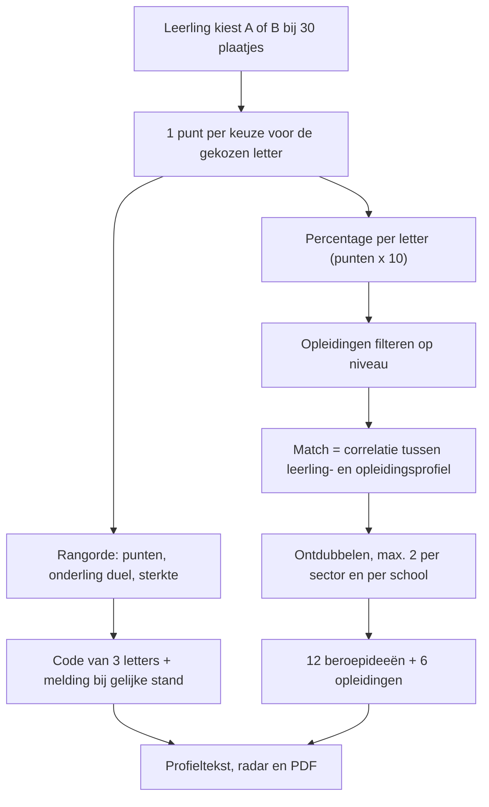

# RIASOC Modeluitleg - weging en resultaatberekening

Deze notitie beschrijft hoe de MBO Opleidingen Verkenner keuzes omzet naar een profiel en daarna naar passende MBO-suggesties. De verkenner is een oriënterend hulpmiddel: hij laat zien welke richtingen aansluiten bij voorkeuren, maar vervangt geen loopbaangesprek, intake of advies van mentor of decaan.

Sinds november 2026 heeft de verkenner 30 vragen in plaats van 62. Waarom, en welke plaatjes zijn gekozen, staat in [RIASOC_30_vragen_ontwerp.md](RIASOC_30_vragen_ontwerp.md).

## 0. Bronnen

| Pad | Inhoud |
|---|---|
| `index.html` | De hele verkenner: vragen, telling, opleidingen en uitslag. |
| `assets/riasoc/` | De 62 plaatjes uit de scènebank, 6 omgewisselde varianten, een nieuw plaatje (63), een samengesteld plaatje (64) en de logo's. |
| `docs/RIASOC_30_vragen_ontwerp.md` | Keuze van de 30 plaatjes en onderbouwing. |
| `docs/RIASOC_Beeldaudit_62_plaatjes.md` | Beeldaudit van alle 62 plaatjes (mei 2026). |
| `tests/riasoc_model_audit.js` | Simulatie en controle van het model. |
| `tools/swap_sides.py` | Wisselt de linker- en rechterscène van een plaatje om. |
| `tools/combine_sides.py` | Maakt één plaatje uit twee scènes van bestaande plaatjes. |

De scènebank, de beeldprompts en het masterdocument met opleidingen staan in de RIASOC-map van de Obsidian-vault.

## 1. Wat wordt gepeild?

| Code | Dimensie | In gewone taal |
|---|---|---|
| R | Realistisch | Doen, maken, bouwen, repareren |
| I | Intellectueel | Onderzoeken, analyseren, begrijpen |
| A | Artistiek | Ontwerpen, verbeelden, creatief maken |
| S | Sociaal | Helpen, begeleiden, zorgen, contact |
| O | Ondernemend | Leiden, overtuigen, organiseren |
| C | Conventioneel | Ordenen, controleren, structureren |

Elke vraag toont twee situaties. De leerling kiest wat meer aanspreekt. Daarmee wordt voorkeur gemeten, geen vaardigheid.

## 2. Waarom 30 vragen?

Zes letters geven 15 mogelijke tweetallen. Met 30 vragen staat elk tweetal precies 2 keer tegenover elkaar en komt elke letter precies 10 keer voor. Dat is een toernooi waarin elke letter evenveel wedstrijden speelt.

De letters staan in een zeshoek: R - I - A - S - O - C - terug naar R. Buren lijken op elkaar, letters tegenover elkaar verschillen het meest.

| Type | Betekenis | Voorbeeld | Aantal vragen |
|---|---|---|---|
| adjacent | buren | I-A, S-O | 12 |
| skip-one | één ertussen | R-A, I-S | 12 |
| opposite | tegenover elkaar | R-S, I-O, A-C | 6 |

Verder geldt:

- elke letter staat 5 keer links en 5 keer rechts;
- vraag 1-15 en vraag 16-30 zijn elk een complete ronde;
- geen letter komt in twee opeenvolgende vragen voor.

`validateDesign()` controleert dit alles. `validateQuestions()` controleert elke vraag afzonderlijk.

## 3. Hoe telt een antwoord mee?

Een keuze is 1 punt voor de letter van de gekozen kant. Er zijn geen bijpunten voor andere letters.

```js
{n:1, src:5, a:'R', b:'S', lA:"Speeltoestel maken", lB:"Op kinderen letten", img:"05-...png"}
```

`a` is de letter van de linkerkant, `b` van de rechterkant, `src` het nummer van het plaatje in de oude reeks van 62.

De eerdere versie gaf 3 punten aan de hoofdletter en 1 punt aan een vaste buurletter. Dat liet R en C, I en A, en S en O samen stijgen, waardoor profielen in drie hoeken belandden.

## 4. Van punten naar percentage

Elke letter kan 10 punten halen. Het percentage is het aantal punten maal 10. Samen hebben de zes letters altijd 30 punten: wie veel voor de ene letter kiest, kiest minder voor de andere.

## 5. Hoe ontstaat de profielcode?

De code bestaat uit de drie hoogste letters, bijvoorbeeld `SIC`.

Omdat de scores in stappen van 10 lopen, staan letters geregeld gelijk. `rankProfile()` beslist dan zo:

1. **Onderling duel.** Wie won bij de plaatjes waar deze letters tegenover elkaar stonden?
2. **Sterkte.** Welke letter versloeg de sterkste andere letters?
3. **Echt gelijk.** De volgorde is dan neutraal: ze hangt af van het antwoordpatroon en niet van de vaste volgorde R-I-A-S-O-C.

Staan plek 3 en 4 gelijk, dan krijgt de leerling een melding dat de vierde letter even hoog scoort en dus ook het bekijken waard is. Staan letters binnen de top 3 gelijk, dan meldt de uitslag dat hun volgorde weinig zegt.

Twee extra meldingen:

- **Zelfde kant.** Wie bij 90% of meer van de vragen dezelfde kant kiest, krijgt het advies de verkenner opnieuw te doen.
- **Vlak profiel.** Ligt de hoogste letter hooguit 20 punten boven de laagste, dan staat erbij dat er nog geen duidelijke richting uit komt.

## 6. Hoe worden MBO-opleidingen gewogen?

Elke opleiding heeft een eigen RIASOC-profiel:

```js
sc: { R: 4, I: 9, A: 5, S: 3, O: 5, C: 7 }
```

De profielen komen uit de kwalificatiedossiers. Voor een aantal groepen legt `applyMboModelCorrections()` er een vast profiel overheen:

| Categorie | Correctieprincipe |
|---|---|
| Entree breed | Geen scherpe code voor een brede entreeopleiding |
| ICT/software | I, C en R expliciet; creatieve software krijgt extra A |
| Techniek | R/I/C gescheiden naar uitvoeren en analyseren |
| Zorg/welzijn | S voorop als helpen en begeleiden de kern is |
| Hospitality/contact | S voorop bij gastcontact; O hoger bij leiding |
| Creatief/media | A voorop, met I en C |
| Ambacht | Smalle R/A/C-profielen |
| Vastgoed/advies | O en C voorop |

De correctie kijkt alleen naar de **naam van de opleiding**. Eerder deden ook schoolnaam, adres en URL mee. Dat gaf toevalstreffers: een opleiding aan de Marten Meesweg werd wegenbouw, en alles met "transport" werd sport.

Opleidingen die in geen categorie vallen houden hun eigen dossierprofiel. Dat zijn er ruim 100, vooral administratie, commercie, logistiek, horeca-keuken, dier en veiligheid.

## 7. Hoe wordt de match berekend?

De match is de **correlatie** tussen de zes scores van de leerling en de zes scores van de opleiding (`profileCorrelation()`). Die loopt van -1 (tegengestelde vorm) tot 1 (zelfde vorm). Het matchpercentage op het scherm is de correlatie maal 100, met 0 als ondergrens.

Het gaat dus om de vorm van het profiel: waar zitten de pieken en dalen? Een opleiding die op alles redelijk hoog scoort heeft geen voordeel.

Voorbeeld: een leerling met hoge S en O en lage R en I past goed bij een opleiding met hoge S en O. Een techniekopleiding met hoge R en lage S krijgt een negatieve correlatie en komt niet in beeld.

## 8. Niveau-filter

| Keuze leerling | Toegestane MBO-niveaus |
|---|---|
| Basis | 2 en 3 |
| Kader | 3 en 4 |
| Gemengde leerweg | 3 en 4 |
| Theoretische leerweg | 3 en 4 |
| Havo | 4 |
| Anders | 2, 3 en 4 |

`niveauMatch()` leest ook samengestelde notaties zoals `MBO 3; 3; 4` en `3; 2 / 3`.

## 9. Waarom 12 beroepideeën en 6 opleidingen?

De uitslag begint breed: voor elk van de drie hoogste letters vier beroepideeën, samen 12 voorbeelden om over te praten.

Daarna kiest `selectSuggestions()` 6 concrete opleidingen:

1. alle opleidingen van het juiste niveau worden gesorteerd op match;
2. dubbele CREBO's en varianten van dezelfde opleiding vallen af;
3. van boven naar beneden worden er 6 gekozen, met hooguit 2 per sector en 2 per school. Lukt dat niet, dan wordt de grens verruimd naar 3.

Veel opleidingen delen hetzelfde RIASOC-profiel en passen dus precies even goed. Welke daarvan vooraan komt hangt af van het antwoordpatroon van de leerling. Zo krijgt niet iedereen met een techniekprofiel dezelfde twee techniekopleidingen. Dezelfde antwoorden geven altijd dezelfde zes.

De kaart toont opleiding, school en locatie (met voorkeur voor Zuid-Holland), een korte motivatie, beroepen, niveau, leerweg, matchpercentage en een link.

## 10. Datastroom



## 11. Wat is belangrijk om erbij te vertellen?

De uitslag is een gespreksstarter. Een hoge score betekent: dit soort situaties sprak je vaak aan. Het zegt niet dat iemand daar al goed in is of dat andere richtingen niet kunnen.

- Kijk eerst naar de hoogste drie letters en naar de laagste.
- Let op de melding bij gelijke stand: de vierde letter kan net zo belangrijk zijn.
- Vraag naar herkenning: klopt dit met wat jij leuk vindt?
- Gebruik de opleidingen als startpunt voor open dagen en proeflessen. Twee leerlingen met hetzelfde profiel kunnen andere voorbeelden zien; dat is de bedoeling.

## 12. Model-audit

```bash
node tests/riasoc_model_audit.js
```

De audit draait op `index.html` zelf en simuleert per groep 600 leerlingen:

1. **Willekeurige klikkers.** Heeft elke letter evenveel kans om bovenaan te komen? Plus een fijnmeting met 60.000 klikkers.
2. **Kant-klikkers.** Altijd links, altijd rechts, om en om, en een voorkeur van 70% voor links.
3. **Leerlingen met een echte voorkeur.** Elke leerling heeft verborgen voorkeuren met de samenhang van de zeshoek en kiest daar met enige ruis naar. Vindt de test die voorkeur terug?

Bij elke groep meet de audit ook de opleidingen: hoeveel verschillende er in beeld komen, hoe vaak de meest getoonde verschijnt, en of de hoofdletter van de opleiding bij de sterkste letters van de leerling hoort.

De audit eindigt met een fout als de vragenset scheef is, als altijd-links geen vlak profiel geeft, of als één opleiding bij meer dan een kwart van de willekeurige klikkers verschijnt.

Uitvoer in `tests/output/`:

| Bestand | Inhoud |
|---|---|
| `riasoc_model_audit.md` | Het rapport. |
| `riasoc_simulatie_600_willekeurig.csv` | Per willekeurige klikker: antwoorden, scores, code en de 6 opleidingen. |
| `riasoc_classificatie_dump.csv` | Per opleiding: sector, correctiecategorie, profiel en code. |

### Laatste uitkomst (2026-11-18)

| Controle | Uitkomst |
|---|---|
| Ontwerp en plaatjes | 0 fouten |
| Willekeurig: letter op plek 1 | tussen 14,2% en 19,8% bij 600; tussen 16,4% en 17,0% bij 60.000 |
| Altijd links of rechts | alle letters 50%, met melding |
| Echte voorkeur: sterkste letter goed | 63% |
| Echte voorkeur: overlap top 3 | 2,53 van 3 |
| Verschillende opleidingen in beeld | 314 van 400 |
| Meest getoonde opleiding | bij 12% van de leerlingen |
| Hoofdletter opleiding in top 3 van leerling | 92% |
