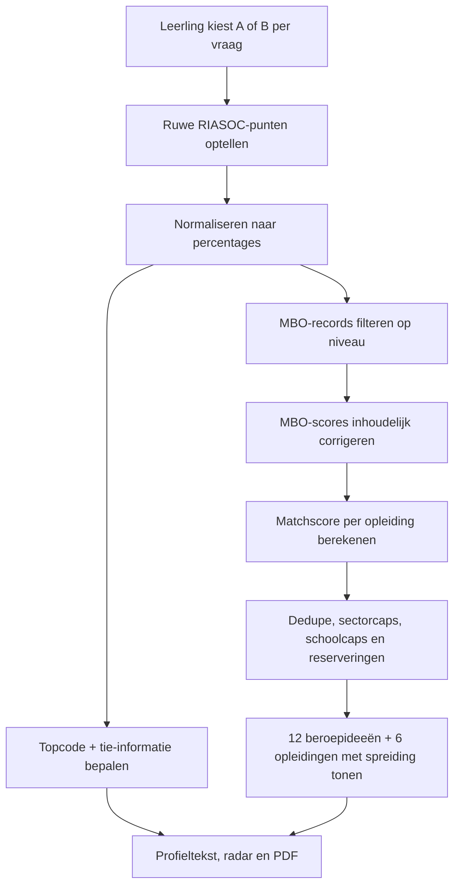

# RIASOC Modeluitleg - weging en resultaatberekening

Deze notitie beschrijft hoe de RIASOC/MBO Opleidingen Verkenner keuzes omzet naar een profiel en daarna naar passende MBO-suggesties. De verkenner is bedoeld als orienterend hulpmiddel: hij laat zien welke richtingen aansluiten bij voorkeuren, maar vervangt geen loopbaangesprek, intake of advies van mentor/decaan.

## 0. Projectmap en bronnen

De RIASOC-werkmap is opgeschoond rond de huidige hoofdstructuur van de Verkenner:

| Pad | Inhoud |
|---|---|
| `RIASOC Wiki.md` | Hoofdingang voor de RIASOC-werkmap. |
| `RIASOC_Modeluitleg_weging_en_resultaat.md` | Deze uitleg: model, weging, resultaatlogica en auditmethode. |
| `02_Model_en_Data/Overzicht_Totaal_Riasoc.md` | Masterdocument met totaaloverzicht en modelinhoud. |
| `03_Scenebank/RIASOC_AB_scenebank_werkdocument.md` | Werkdocument voor A/B-scenes en vraagbank. |
| `04_Prompts/RIASOC_Nano_Banana_prompts.md` | Promptlaag voor beeldgeneratie. |
| `05_Assets/Quiz_62/` | Definitieve lokale PNG-set voor Q01-Q62 plus Corbulo-logo's. |
| `05_Assets/Conceptbeelden_v1/` | Oudere/conceptuele gegenereerde beeldreeks. |
| `06_Backups/` | Backups van eerdere model- en datacorrecties. |
| `07_Archive/` | Oud visueel materiaal en superseded previews. |

De softwarebron staat in de GitHub/local repo:

```text
/Users/michelbuchner/mbo-verkenner/index.html
```

De model-audit in de repo staat hier:

```text
/Users/michelbuchner/mbo-verkenner/tests/riasoc_model_audit.js
/Users/michelbuchner/mbo-verkenner/tests/output/riasoc_model_audit.md
```

## 1. Wat wordt gepeild?

De vragen peilen voorkeuren langs de zes RIASOC-dimensies:

| Code | Dimensie | In gewone taal |
|---|---|---|
| R | Realistisch | Doen, maken, bouwen, repareren |
| I | Intellectueel | Onderzoeken, analyseren, begrijpen |
| A | Artistiek | Ontwerpen, verbeelden, creatief maken |
| S | Sociaal | Helpen, begeleiden, zorgen, contact |
| O | Ondernemend | Leiden, overtuigen, organiseren |
| C | Conventioneel | Ordenen, controleren, structureren |

Elke vraag toont twee situaties. De leerling kiest niet wat "beter" is, maar wat meer aanspreekt. Daarmee wordt voorkeur gemeten, geen vaardigheid.

## 2. Waarom 62 vragen?

De vragen zijn opgebouwd rond de hexagon-volgorde:

```text
R - I - A - S - O - C - terug naar R
```

Die volgorde komt uit het RIASOC-model: naast elkaar liggende dimensies zijn inhoudelijk verwant, tegenoverliggende dimensies verschillen sterker.

De set bevat meerdere typen vergelijkingen:

| Type | Betekenis | Voorbeeld |
|---|---|---|
| adjacent | Vergelijking tussen verwante buren | I-A, S-O |
| skip-one | Vergelijking met een tussenstap | A-O, C-I |
| opposite | Vergelijking met maximale afstand | R-S, I-O, A-C |

In de software krijgt elke vraag daarom metadata:

```js
pair: "I-A"
pairType: "adjacent"
expectedType: "adjacent"
```

`validateQuestions()` controleert of deze metadata klopt met de hexagon-volgorde, of alle 62 afbeeldingen gevuld zijn, en of elke antwoordkant een duidelijke hoofddimensie heeft.

## 3. Hoe telt een antwoord mee?

Elke antwoordoptie heeft een kleine scoreverdeling. De hoofddimensie krijgt meestal 3 punten. Een ondersteunende dimensie krijgt meestal 1 punt.

Voorbeeld:

```js
wA: { R: 3, C: 1 }
wB: { S: 3, O: 1 }
```

Als een leerling A kiest, krijgt het profiel:

- R +3
- C +1

Als een leerling B kiest:

- S +3
- O +1

Deze 3/1-weging voorkomt dat een keuze te plat wordt. Een praktische scene kan bijvoorbeeld vooral Realistisch zijn, maar ook iets Conventioneels hebben omdat nauwkeurig werken belangrijk is. Een helpende scene kan vooral Sociaal zijn, maar ook iets Ondernemends hebben als iemand uitleg geeft of anderen activeert.

## 4. Van ruwe score naar percentage

Niet elke dimensie komt exact even vaak en even zwaar in alle vraagkanten terug. Daarom gebruikt de software normalisatie.

Voor elke dimensie wordt eerst berekend wat de maximaal haalbare score is:

```js
maxScore[dimensie] = som van de hoogste haalbare score per vraag
```

Daarna wordt de score omgezet naar een percentage:

```text
percentage = afgerond(ruweScore / maxScore * 100)
```

Daardoor betekent 70 procent bij Sociaal hetzelfde soort signaal als 70 procent bij Realistisch: de leerling heeft relatief vaak gekozen voor situaties waarin die dimensie belangrijk was.

## 5. Hoe ontstaat de profielcode?

De profielcode bestaat uit de drie hoogste dimensies, bijvoorbeeld:

```text
SIC
```

Dat betekent: Sociaal staat het sterkst, daarna Intellectueel, daarna Conventioneel.

De oude versie koos bij gelijke scores stilzwijgend volgens de vaste volgorde R-I-A-S-O-C. Dat is aangepast. De software gebruikt nu `topCodeMeta()`:

- dimensies worden gegroepeerd per score;
- exacte gelijke scores worden zichtbaar vastgelegd;
- bijna-gelijke scores rond de grens worden gemeld;
- de code toont nog steeds een top 3, maar de scorebalken en tie-melding blijven leidend.

Belangrijk: bij gelijke of bijna gelijke scores moet de code niet worden gelezen als harde rangorde. Dan is het profiel breder.

## 6. Hoe worden MBO-opleidingen gewogen?

Elke MBO-record heeft zelf ook een RIASOC-profiel:

```js
sc: { R: 4, I: 9, A: 5, S: 3, O: 5, C: 7 }
```

Deze scores beschrijven wat de opleiding of beroepsrichting vooral vraagt. Een softwareopleiding krijgt bijvoorbeeld expliciet I/C/R of I/A/C, afhankelijk van de inhoud. Een zorgopleiding krijgt S als primaire dimensie. Techniek wordt niet meer als een brede klomp behandeld, maar gescheiden in R/I/C: uitvoeren, analyseren en nauwkeurig werken.

De huidige correctielagen zijn:

| Categorie | Correctieprincipe |
|---|---|
| Entree breed/orienterend | Niet doen alsof een brede entreeopleiding een scherpe RIASOC-code heeft |
| ICT/software | I, C en R expliciet; creatieve software krijgt extra A |
| Techniek | R/I/C gescheiden naar uitvoeren, analyse en nauwkeurigheid |
| Zorg/welzijn/contact | S primair als helpen, begeleiden of contact de kern is |
| Hospitality/contact | S primair bij gastcontact; O hoger bij leiding/ondernemen |
| Creatief/media | A/I/C inhoudelijk gewogen, niet door tie-volgorde |
| Ambacht/precisie | Smalle R/A/C-profielen voor niche-ambachten, zodat ze niet als algemene match domineren |
| Vastgoed/advies | O/C/I/R gescheiden voor organiseren, adviseren en projectmatig werken |

Na die correctie krijgt elk MBO-record een expliciete `codeMeta` en `code`. De selectie is dus niet meer afhankelijk van lege `code:""` velden of toevallige volgorde in de data.

## 7. Hoe wordt de match berekend?

De match tussen leerling en opleiding is een gewogen overeenkomst tussen twee profielen.

Voor elke dimensie:

```text
leerlingPercentage / 100 * opleidingScore / 10
```

Daarna worden de zes bijdragen bij elkaar opgeteld:

```text
match = som over R, I, A, S, O, C
```

Een opleiding scoort dus hoog als zij sterk is op dimensies waarop de leerling ook hoog scoort.

Voorbeeld in woorden:

- Leerling scoort hoog op S en C.
- Een opleiding met S=10 en C=6 krijgt veel matchbijdrage.
- Een opleiding met vooral R en weinig S krijgt minder matchbijdrage, ook als die opleiding op zichzelf een duidelijke beroepsrichting heeft.

## 8. Niveau-filter

Voor de suggesties wordt ook gekeken naar de gekozen vooropleiding:

| Keuze leerling | Toegestane MBO-niveaus |
|---|---|
| Basis | 2 en 3 |
| Kader | 3 en 4 |
| Gemengde leerweg | 3 en 4 |
| Theoretische leerweg | 3 en 4 |
| Havo | 4 |
| Anders | 2, 3 en 4 |

`niveauMatch()` leest nu ook samengestelde strings goed, bijvoorbeeld:

```text
MBO 3; 3; 4
2, 3, 4; 4
3; 2 / 3
```

Daarmee vallen opleidingen niet weg door rommelige niveau-notatie.

## 9. Waarom ziet de leerling 12 beroepideeën en 6 opleidingen?

De uitslag begint breed. Voor de hoogste drie RIASOC-dimensies toont de verkenner telkens vier beroepideeën. Dat geeft samen 12 voorbeelden om over te praten. Die voorbeelden zijn bewust niet te smal: ze helpen een leerling woorden te geven aan mogelijke richtingen voordat er meteen een concrete opleiding wordt gekozen.

Daarna berekent de software voor alle passende MBO-records een matchscore. Uit die lijst worden 6 concrete opleidingen gekozen met een extra diversiteitslaag:

- de beste pure match blijft altijd zichtbaar;
- dubbele CREBO's en dubbele opleidingsstammen worden uit dezelfde uitslag geweerd;
- per sectorfamilie geldt in de hoofdselectie een maximum van 2;
- per school geldt in de hoofdselectie een maximum van 1, met alleen in de fallback ruimte voor een tweede;
- de hoogste RIASOC-dimensie reserveert een passende sectorfamilie;
- de tweede dimensie reserveert ook een familie als die score 60 procent of hoger is;
- een derde dimensie kan zacht meewegen als die 70 procent of hoger is;
- gereserveerde opleidingen moeten minimaal 70 procent van de topmatch halen.

Zo ontstaat spreiding: niet zes bijna dezelfde opleidingen uit één dominante categorie, maar een compacte set die de breedte van het profiel laat zien.

De suggestiekaart toont:

- opleiding;
- één gekozen school en locatie, met voorkeur voor Zuid-Holland als er meerdere aanbieders in één record staan;
- korte motivatie;
- beroepsrollen;
- niveau en leerweg;
- matchpercentage;
- link naar de opleiding als die bekend is.

De motivatie wordt automatisch opgebouwd uit de overlap tussen het leerlingprofiel en het opleidingsprofiel. Daardoor staat er niet alleen "past bij jou", maar ook waarom.

De matchscore is een overeenkomstsscore over zes dimensies. In de interface wordt die score genormaliseerd naar een begrijpelijke 0-100 procent, zodat er geen percentages boven 100 procent verschijnen.

## 10. Datastroom in het kort



## 11. Wat is belangrijk om erbij te vertellen?

De uitslag is een gesprekstarter. Een hoge score betekent: "dit soort situaties sprak je vaak aan". Het betekent niet automatisch dat iemand daar al goed in is of dat andere richtingen niet kunnen.

Gebruik de uitkomst daarom zo:

- Kijk eerst naar de hoogste drie dimensies.
- Kijk daarna naar bijna-gelijke scores.
- Bespreek herkenning: "Klopt dit met wat jij leuk vindt?"
- Gebruik de MBO-suggesties als startpunt voor open dagen, proeflessen en gesprekken.
- Laat leerlingen ook opleidingen bekijken die net buiten de 6 getoonde opties vallen als ze nieuwsgierig zijn.

## 12. Kwaliteitscontrole

De software controleert op dit moment:

- precies 62 vragen;
- alle vragen hebben een afbeelding;
- Q32-Q62 zijn gevuld;
- elke vraag heeft `pair`, `pairType` en `expectedType`;
- vraagmetadata klopt met de R-I-A-S-O-C hexagon;
- MBO-records hebben expliciete codes;
- niveaufilters herkennen samengestelde notaties;
- PDF gebruikt dezelfde berekening als het schermresultaat.

Bij nieuwe data of nieuwe afbeeldingen moet opnieuw `validateQuestions()` worden uitgevoerd en moeten enkele vaste niveau-testcases slagen.

## 13. Geautomatiseerde model-audit

Naast de handmatige controle is er nu een audit-tool:

```bash
node tests/riasoc_model_audit.js
```

Deze tool draait rechtstreeks op `index.html`. Hij laadt de bestaande vragen, MBO-records en functies in een Node VM-context en gebruikt dus dezelfde logica als de website:

- `norm()` voor normalisatie;
- `topCodeMeta()` voor topcode en tie-informatie;
- `selectSuggestions()` voor de 6 opleidingen;
- `selectedProvider()` voor school- en locatiekeuze;
- `validateQuestions()` en `validateNiveauMatchCases()` voor basale datakwaliteit.

De audit simuleert:

- 6 zuivere profielen, één per RIASOC-dimensie;
- alle 15 combinaties van twee dimensies;
- alle 20 combinaties van drie dimensies;
- vaste patronen zoals alle A, alle B en om-en-om;
- 5 seeded random profielen voor de 50-simulatie-tabel;
- 1000 random antwoordreeksen.

Per scenario worden vastgelegd:

- ruwe en genormaliseerde RIASOC-scores;
- topcode;
- verschillen tussen plek 1-2, 2-3 en 3-4;
- aantal beroepideeën;
- de 6 concrete opleidingen;
- aantal unieke scholen;
- dimensies die in de opleidingenset terugkomen;
- sectorfamilies, herhaalde CREBO's en dominante scholen.

De audit schrijft het rapport naar:

```text
tests/output/riasoc_model_audit.md
```

De 50-simulatie-tabel staat als CSV in:

```text
tests/output/riasoc_50_simulaties.csv
```

### Laatste auditresultaat

Auditdatum: 2026-05-01.

| Controle | Uitkomst |
|---|---:|
| Vraagvalidatie | 0 fouten |
| Niveau-testcases | geslaagd |
| Scenario's getest | 50 |
| Random simulaties | 1000 |
| Unieke topcodes in random simulaties | 114 |
| Unieke sets van 6 opleidingen | 403 |
| Scenario's met kleine verschillen of ties | 25 |
| Scenario's met lage variatie in 6 opleidingen | 0 |

Interpretatie: de scoreberekening, topcode-spreiding en concrete opleidingsselectie zijn nu op hoofdlijnen gezond. Kleine verschillen blijven zichtbaar via de tie/gap-informatie, maar leiden niet meer tot één vaste standaarduitkomst. In de 50 scenario's is geen enkele uitslag meer gemarkeerd als lage variatie.

De belangrijkste frequenties in 50 simulaties:

| Type | Meest voorkomend | Aantal |
|---|---|---:|
| Opleiding | Assistant Fashion Tailor | 19 |
| Opleiding | Creatief vakman (ontwerpen en maken met hout) | 18 |
| Opleiding | Gespecialiseerd productiemedewerker voedingsmiddelenindustrie (VAPRO) | 16 |
| CREBO | 25684 | 19 |
| CREBO | 25548 | 18 |
| CREBO | 25979 | 16 |
| School | MBO Rijnland | 47 |
| School | HMC | 44 |
| School | ROC Da Vinci College | 43 |
| Sectorfamilie | Techniek & maken | 64 |
| Sectorfamilie | Horeca & toerisme | 48 |
| Sectorfamilie | Commercieel & ondernemend | 47 |

Belangrijkste verbetering: de concrete selectie gebruikt nu deduplicatie, sectorcaps, schoolcaps en reserveringen per dominante dimensie. Daardoor krijgt een sociaal profiel bijvoorbeeld zichtbaar ruimte voor zorg/welzijn als de match boven de minimale scorevloer komt, zonder dat commerciele of administratieve S/O/C-overlap de hele set vult.

Resterend aandachtspunt: de topfrequenties zijn nog niet volledig vlak. Dat hoeft ook niet; sommige opleidingen passen nu eenmaal bij veel samengestelde profielen. De volgende verfijning kan gericht kijken naar sectorfamilies die structureel ondervertegenwoordigd zijn, vooral onderwijs/sport en logistiek/transport, en naar uitbreiding of betere tagging van de onderliggende dataset.

De audit bracht ook twee praktische verbeterpunten aan het licht:

- De matchscore werd eerst als percentage getoond zonder normalisatie, waardoor waarden boven 100 procent mogelijk waren. Dit is gecorrigeerd naar een 0-100 procentweergave.
- Locaties met HTML-entiteiten, zoals `B&#232;taplein`, konden verkeerd worden gesplitst op de puntkomma in de entiteit. `splitField()` beschermt HTML-entiteiten nu voordat velden worden gesplitst.
